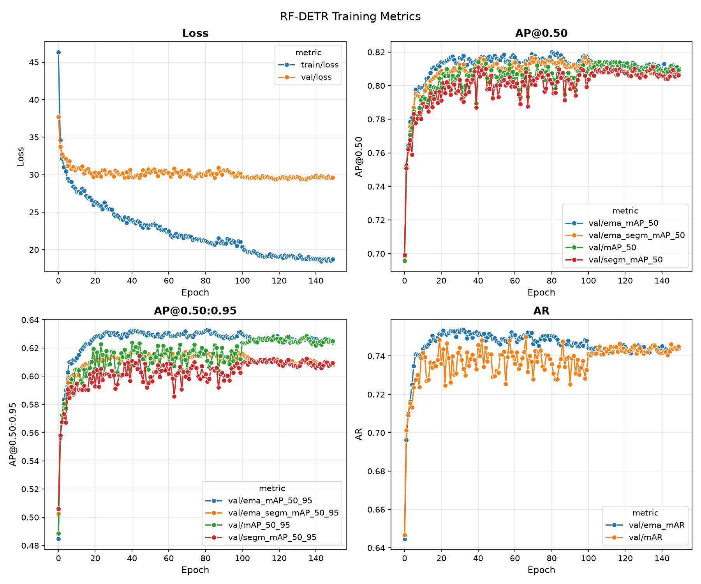

# RF-DETR Paddy Crops Segmentation

[](https://www.python.org/)
[](https://github.com/roboflow/rf-detr)
[](https://docs.astral.sh/uv/)

This project focuses on training and evaluating the **RF-DETR (`RFDETRSegLarge`)** model for instance segmentation of paddy crop fields using Google Satellite Imagery in the **Jakarta-Bandung Mega-Urban Region (JBMUR), Indonesia**.

In addition to standard training and evaluation using COCO mAP metrics, this repository includes a geospatial inference pipeline for large GeoTIFF imagery (*sliding window inference*) and automated graph-based polygon merging to generate vector outputs (*Shapefiles*).

---

## Key Features

- **Instance Segmentation with RF-DETR**: Utilizes the `RFDETRSegLarge` architecture.
- **Comprehensive Evaluation**: Performance benchmarking using COCO Mean Average Precision (mAP) metrics.
- **Large-Scale Geospatial Inference**: Supports prediction on high-resolution `.tif` imagery using an overlapping *sliding window* approach.
- **Automated Spatial Post-Processing**: Converts segmentation masks into georeferenced polygons and merges overlapping polygons across windows using connected-component graph analysis (`networkx` & `geopandas`).

---

## Dataset

The dataset consists of paddy field imagery along with corresponding instance segmentation annotations.

- **Download Dataset**: [Google Drive Dataset Link](https://drive.google.com/uc?id=1B1Kr8NtaKg3HIzs-jlDgH5GNvpBMY9Ti)

The training notebook automatically downloads `datasets.zip` using `gdown` and extracts it into the `datasets/` directory.

---

## Environment Setup

This project uses **[uv](https://docs.astral.sh/uv/)** for fast and reproducible package and virtual environment management.

### 1. Sync Dependencies
Run the following command in the project root directory to create a virtual environment and install all dependencies specified in `pyproject.toml`:

```bash
uv sync
```

### 2. Run Jupyter Notebook
To open and run the experiments inside the notebook:

```bash
uv run --with jupyter jupyter lab
```
*(Alternatively, use `uv run --with jupyter jupyter notebook` depending on your preference).*

---

## Training Configuration

Model training is conducted through the [`training.ipynb`](./training.ipynb) notebook with the following hyperparameter configuration:

| Parameter | Value |
| :--- | :--- |
| **Model Architecture** | `RFDETRSegLarge` (35.6M Params) |
| **Epochs** | 150 |
| **Batch Size** | 16 (`grad_accum_steps=1`) |
| **Learning Rate** | `1e-4` |
| **Input Resolution** | 504 $\times$ 504 pixels |
| **Augmentations** | `HorizontalFlip`, `VerticalFlip`, `RandomRotate90` |
| **Training Hardware** | NVIDIA A100-SXM4-80GB |

---

## Training & Evaluation Results

### 1. Validation & Test Set Performance (COCO mAP)
After training for 150 epochs, the best checkpoint achieved a **Best EMA mAP of `0.6329`** (and Regular mAP of `0.6284`).

Evaluation on the **Test Set** (`threshold = 0.5`) yielded the following metrics:

| Evaluation Metric | IoU Threshold | Area | Score |
| :--- | :---: | :---: | :---: |
| **mAP (0.50:0.95)** | `0.50:0.95` | All | **0.602** |
| **AP@50** | `0.50` | All | **0.742** |
| **AP@75** | `0.75` | All | **0.644** |
| **mAP (Small)** | `0.50:0.95` | Small | 0.217 |
| **mAP (Medium)** | `0.50:0.95` | Medium | 0.627 |
| **mAP (Large)** | `0.50:0.95` | Large | 0.679 |

#### Training Metrics Plot


### 2. Geospatial Inference Evaluation (Shapefile IoU)
Full-polygon mapping evaluation across 26 validation GeoTIFF tiles (`window_size=504`, `overlap=100`, `conf_thresh=0.4`, `merge_thresh=0.5`) against ground-truth Shapefiles clipped to each tile's spatial extent (via [`validation.ipynb`](./validation.ipynb)):

| Validation Sample (`Val ID`) | Ground Truth Polygons (`N Groundtruth`) | Predicted Polygons (`N Prediction`) | Spatial Accuracy (`Accuracy IoU`) |
| :--- | :---: | :---: | :---: |
| **`val_16`** | 92 | 94 | 75.48% |
| **`val_3`** | 49 | 52 | 89.54% |
| **`val_8`** | 152 | 151 | 83.92% |
| **`val_39`** | 19 | 16 | 89.17% |
| **`val_34`** | 42 | 42 | **92.19%** |
| **`val_44`** | 338 | 270 | 86.06% |
| **`val_15`** | 102 | 105 | 81.73% |
| **`val_4`** | 26 | 30 | 82.92% |
| **`val_36`** | 166 | 174 | 77.87% |
| **`val_18`** | 57 | 64 | 70.99% |
| **`val_9a`** | 83 | 81 | **94.20%** |
| **`val_43`** | 92 | 95 | 77.95% |
| **`val_33`** | 91 | 75 | 78.27% |
| **`val_20`** | 207 | 193 | 81.60% |
| **`val_41`** | 199 | 163 | 85.76% |
| **`val_36b`** | 164 | 185 | 83.31% |
| **`val_32`** | 56 | 64 | 85.31% |
| **`val_35`** | 57 | 53 | **90.16%** |
| **`val_28`** | 103 | 105 | 74.38% |
| **`val_21`** | 97 | 90 | **90.26%** |
| **`val_7`** | 30 | 39 | 77.97% |
| **`val_22`** | 160 | 127 | 85.56% |
| **`val_38`** | 181 | 147 | 89.19% |
| **`val_31`** | 91 | 89 | **94.02%** |
| **Average / Total** | **2,654 (Total)** | **2,504 (Total)** | **84.08% (Mean IoU)** |

---

## Project Structure

```text
rfdetr-paddy-crops/
├── datasets/                  # Dataset directory (automatically downloaded via notebook)
├── output/                    # Model checkpoints (.pth), metric logs, and training plots
├── prediction/                # Visualized inference results on the test set
├── validation/                # Geospatial validation data (.tif, ground truth & predicted .shp)
├── training.ipynb             # Model training and COCO mAP test evaluation notebook
├── validation.ipynb           # Large-scale GeoTIFF sliding-window inference & Shapefile IoU evaluation
├── pyproject.toml             # Project configuration and Python dependencies
├── uv.lock                    # uv dependency lockfile
└── README.md                  # Project documentation
```
